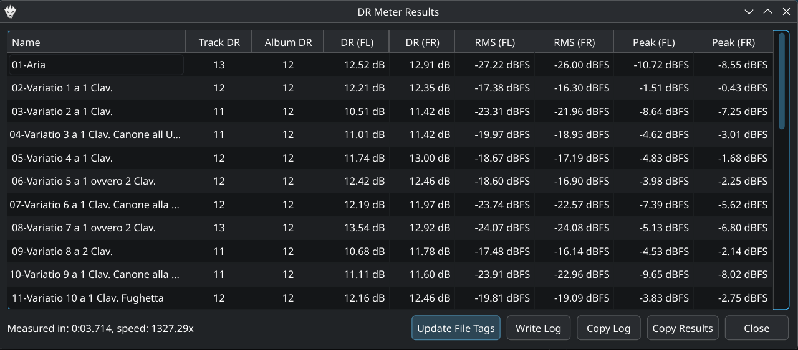

# fooyin-drmeter

[](https://github.com/husubtw/fooyin-drmeter/actions/workflows/ci.yml)
[](LICENSE)
[](https://github.com/fooyin/fooyin)

Offline Dynamic Range (`TT DR14`) scanner plugin for [Fooyin](https://github.com/fooyin/fooyin) `0.15.1`. Measurement behavior, results dialog columns, and 80-column `foo_dr.txt` logs follow foobar2000's `foo_dr_meter v1.0.8` for compatibility with `dr.loudness-war.info`.



*DR Meter Results scanning Kimiko Ishizaka's Open Goldberg Variations (CC0, 24-bit/96 kHz FLAC) in Fooyin 0.15.1 — see [docs/foo_dr_example.txt](docs/foo_dr_example.txt) for the full log output.*

## Features

- Per-track and Official Album TT DR14 measurement grouped by album tags (falling back to directory path when untagged).
- Per-channel DR, AES17 RMS, and unclipped sample peak (including `> 0 dBFS` float peaks) for mono, stereo, and multichannel tracks, excluding LFE channels from the DR average.
- Interactive results dialog with 3-state numerical column sorting (Ascending → Descending → Unsorted, keeping `Error` and missing channel cells pinned at the bottom), `Ctrl+C` / right-click **Copy** for selected rows, and a compact/verbose table mode toggle.
- Native Fooyin settings integration under **Preferences → Advanced → Tools → DR Meter** (album grouping pattern, default log file name with path-safety validation, single-track `ALBUM DYNAMIC RANGE` toggle, and verbose results dialog toggle).
- Sample-exact CUE subsong analysis (external `.cue` and embedded cuesheets) and DSF/DSD decoding.
- Single- and multi-album `foo_dr.txt` export with directory grouping and overwrite confirmation, plus clipboard export for logs and sorted TSV tables.
- Extra-tag writing for `DYNAMIC RANGE` and `ALBUM DYNAMIC RANGE`.

Technical details and math definitions are documented in [docs/DR_SPEC.md](docs/DR_SPEC.md).

<details>
<summary>Example foo_dr.txt output</summary>

```text
fooyin 0.15.1 / DR Meter v0.1.1
log date: 2026-11-26 20:14:13

--------------------------------------------------------------------------------
Analyzed: Kimiko Ishizaka / J.S. Bach: "Open" Goldberg Variations, BWV 988 (Piano)
--------------------------------------------------------------------------------

DR         Peak           RMS       Duration Track
--------------------------------------------------------------------------------
DR13      -8.55 dBFS   -26.57 dBFS      5:00 01-Aria
DR12      -0.43 dBFS   -16.81 dBFS      1:55 02-Variatio 1 a 1 Clav.
DR11      -7.25 dBFS   -22.58 dBFS      2:04 03-Variatio 2 a 1 Clav.
DR11      -3.01 dBFS   -19.43 dBFS      1:57 04-Variatio 3 a 1 Clav. Canone all Unisuono
DR12      -1.68 dBFS   -17.87 dBFS      1:09 05-Variatio 4 a 1 Clav.
DR12      -2.25 dBFS   -17.67 dBFS      1:34 06-Variatio 5 a 1 ovvero 2 Clav.
DR12      -5.62 dBFS   -23.12 dBFS      1:38 07-Variatio 6 a 1 Clav. Canone alla Seconda
DR13      -5.13 dBFS   -24.07 dBFS      2:12 08-Variatio 7 a 1 ovvero 2 Clav.
DR11      -2.14 dBFS   -16.76 dBFS      1:57 09-Variatio 8 a 2 Clav.
DR11      -8.02 dBFS   -23.41 dBFS      2:06 10-Variatio 9 a 1 Clav. Canone alla Terza
DR12      -2.75 dBFS   -19.44 dBFS      1:46 11-Variatio 10 a 1 Clav. Fughetta
DR12      -3.92 dBFS   -18.99 dBFS      2:09 12-Variatio 11 a 2 Clav.
DR11      -3.43 dBFS   -18.12 dBFS      2:16 13-Variatio 12 Canone alla Quarta
DR11      -8.58 dBFS   -24.20 dBFS      4:14 14-Variatio 13 a 2 Clav.
--------------------------------------------------------------------------------

Number of tracks:  14
Official DR value: DR12

Samplerate:        96000 Hz
Channels:          2
Bits per sample:   24
Bitrate:           2179 kbps
Codec:             FLAC
================================================================================
```

Raw file: [docs/foo_dr_example.txt](docs/foo_dr_example.txt)

</details>

## Compatibility & Requirements

- **Tested platforms:** Linux with Fooyin `0.15.1` (Arch Linux, Fedora 45, and Ubuntu 24.04 via the official Fooyin Linux SDK).
- **Plugin ABI:** Fooyin plugins are native C++ binaries bound to the Fooyin plugin IID and Qt 6 ABI; build against the installed Fooyin/Qt 6 version and rebuild after Fooyin upgrades.
- **Prebuilt GitHub Releases:** Tagged `.fyplugin` release bundles target the **Ubuntu 24.04 / Fooyin 0.15.1 / Qt 6.4 (`x86_64`)** ABI only (verified with `SHA256SUMS.txt`). They will **not** work on Arch Linux, Fedora, or Flatpak — build from source (or install via AUR on Arch Linux) on those systems.
- **Untested platforms:** Windows and FreeBSD are untested in v0.1 (PRs welcome).
- **Toolchain:** C++23 compiler with `<format>` (GCC 13+ or equivalent Clang; Debian 12 Bookworm's default GCC 12 is too old), Qt 6.4+, CMake >= 3.21, Ninja, and Fooyin `0.15.1` headers/SDK. GoogleTest is optional and only required when `-DBUILD_TESTING=ON`.

## Build & Install

| Platform / Method | Instructions |
| --- | --- |
| Arch Linux | [Arch Linux (and derivatives such as CachyOS, Manjaro)](#arch-linux-and-derivatives-such-as-cachyos-manjaro) |
| Fedora 45+ | [Fedora (45+ with native `fooyin-devel` 0.15.1)](#fedora-45-with-native-fooyin-devel-0151) |
| Ubuntu 24.04 SDK | [Ubuntu 24.04 (using Fooyin's official Linux SDK)](#ubuntu-2404-using-fooyins-official-linux-sdk) |
| `.fyplugin` Bundle | [Building a `.fyplugin` Bundle (GUI Install / AppImage / Flatpak)](#building-a-fyplugin-bundle-gui-install--appimage--flatpak) |

### Arch Linux (and derivatives such as CachyOS, Manjaro)

```bash
sudo pacman -S --needed fooyin cmake ninja base-devel
cmake --preset release
cmake --build --preset release
cmake --install build-release --prefix ~/.local
```

This installs `fyplugin_drmeter.so` to `~/.local/lib/fooyin/plugins/fyplugin_drmeter.so`.

### Fedora (45+ with native `fooyin-devel` 0.15.1)

```bash
sudo dnf install gcc-c++ cmake ninja-build qt6-qtbase-devel fooyin-devel
cmake --preset release -DDRMETER_PLUGIN_INSTALL_DIR=lib/fooyin/plugins
cmake --build --preset release
cmake --install build-release --prefix ~/.local
```

Fedora's `fooyin-devel` defaults `FOOYIN_PLUGIN_INSTALL_DIR` to `lib64/fooyin/plugins`, which works for system-wide packaging (`--prefix /usr`). For user-local installs under `~/.local`, `-DDRMETER_PLUGIN_INSTALL_DIR=lib/fooyin/plugins` is required because Fooyin only scans `~/.local/lib/fooyin/plugins`.

### Ubuntu 24.04 (using Fooyin's official Linux SDK)

```bash
sudo apt-get update
sudo apt-get install -y --no-install-recommends \
  build-essential cmake ninja-build pkg-config ca-certificates curl xz-utils \
  qt6-base-dev libqt6svg6 libqt6sql6-sqlite \
  libavcodec60 libavfilter9 libavformat60 libavutil58 libswresample4 \
  libicu74 libtag1v5 libarchive13t64 zlib1g libqcoro6core0t64 libqcoro6network0t64

curl --fail --location --output fooyin-sdk.tar.xz \
  https://github.com/fooyin/fooyin/releases/download/v0.15.1/fooyin-sdk-0.15.1-linux-x64-qt6.4.tar.xz
echo "5b90b16628cdcd8f9a58ad087b03f58da1174948e475ab077d84fd22eeb1b090  fooyin-sdk.tar.xz" | sha256sum -c -
mkdir -p fooyin-sdk
tar -xJf fooyin-sdk.tar.xz -C fooyin-sdk --strip-components=1

cmake --preset release -DCMAKE_PREFIX_PATH="$PWD/fooyin-sdk"
cmake --build --preset release
cmake --install build-release --prefix ~/.local
```

These package names and the official SDK tarball target Ubuntu 24.04 (`noble`) SONAMEs; Debian 13 and other derivatives need matching distro packages or a local Fooyin build.

### Building a `.fyplugin` Bundle (GUI Install / AppImage / Flatpak)

```bash
cmake -S . -B build-bundle -G Ninja \
  -DCMAKE_BUILD_TYPE=Release \
  -DBUILD_TESTING=OFF \
  -DDRMETER_PACKAGE_BUNDLE=ON
cmake --build build-bundle --target package_plugin
```

(Pass `-DCMAKE_PREFIX_PATH="$PWD/fooyin-sdk"` when building against the SDK tarball.)

This produces `build-bundle/fooyin-drmeter-linux-x64.fyplugin`, which can be installed via Fooyin's plugin installer. Fooyin extracts user plugins to `~/.local/lib/fooyin/plugins` for native packages and AppImage, and `~/.var/app/org.fooyin.fooyin/.local/lib/fooyin/plugins` for Flatpak. The bundle must still match the target Fooyin/Qt 6 ABI.

### Run Without Installing

```bash
FOOYIN_PLUGIN_PATH="$PWD/build-release" fooyin
```

## Usage

1. Select one or more tracks or albums in Fooyin.
2. Right-click and choose **Dynamic Range Meter** (also bindable in Fooyin Shortcuts as `DrMeter.MeasureDynamicRange`).
3. Review track and per-channel DR/RMS/Peak values:
   - Click any column header to cycle sorting (**Ascending → Descending → Unsorted**); `Error` rows and missing channel cells stay pinned at the bottom.
   - Select rows and press `Ctrl+C` (or right-click → **Copy**) to copy selected rows as TSV without a header.
   - Use **Update File Tags**, **Write Log**, **Copy Log**, or **Copy Results** (copies all valid rows with a header in the current sort order and verbose/compact column layout).
4. Configure plugin behavior under **Preferences → Advanced → Tools → DR Meter** (`Album grouping pattern`, `Log file name`, `Write ALBUM DYNAMIC RANGE for single-track albums`, and `Verbose results dialog`).

## Behavior Notes

- **Tag writing:** **Update File Tags** writes only `DYNAMIC RANGE` and `ALBUM DYNAMIC RANGE` as plain integers (e.g., `13`) and preserves all other tags.
- **CUE and read-only safety:** CUE subsongs (external and embedded), archive entries, remote streams, and read-only formats are skipped during tag writes so single-file images are never overwritten.
- **Lossy formats:** Lossy tracks (MP3, Opus, Ogg, AAC) omit the `Bits per sample:` line in `foo_dr.txt`.
- **DSF / DSD:** DSD tracks are decoded to PCM through Fooyin; DR values stay within ±1 DR of `foo_dr_meter`, while absolute dBFS peak/RMS levels may differ depending on DSD-to-PCM filter gain.

## Development & Documentation

```bash
# Development build + unit and integration tests
cmake --preset dev && cmake --build --preset dev && ctest --preset dev --output-on-failure

# AddressSanitizer + UndefinedBehaviorSanitizer build & test
cmake --preset asan && cmake --build --preset asan && ctest --preset asan --output-on-failure

# Standalone core library build & tests (no Fooyin required)
cmake -B build-core -G Ninja -DDRMETER_BUILD_PLUGIN=OFF -DBUILD_TESTING=ON
cmake --build build-core && ctest --test-dir build-core --output-on-failure
```

See [CONTRIBUTING.md](CONTRIBUTING.md) for formatting/lint checks and [docs/DR_SPEC.md](docs/DR_SPEC.md) for the full technical specification.

## License

Licensed under `GPL-3.0-or-later`. See [LICENSE](LICENSE).
